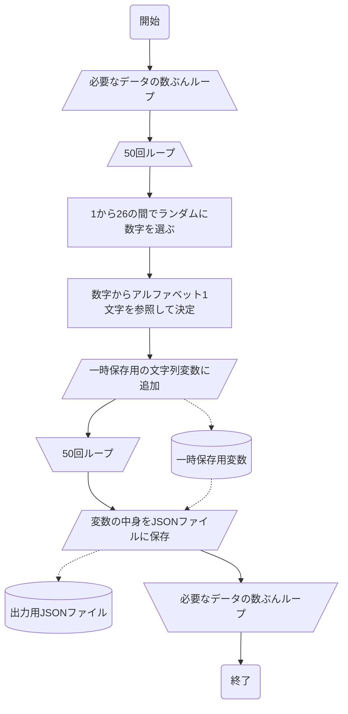
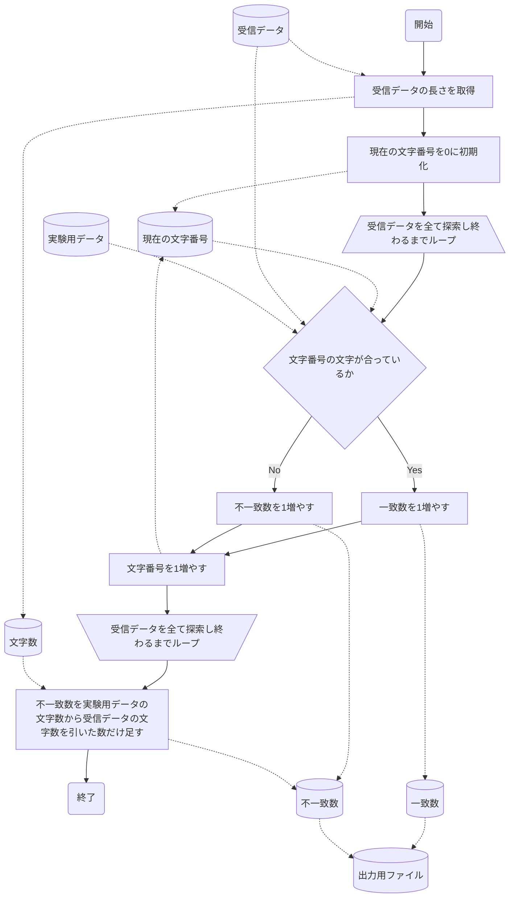
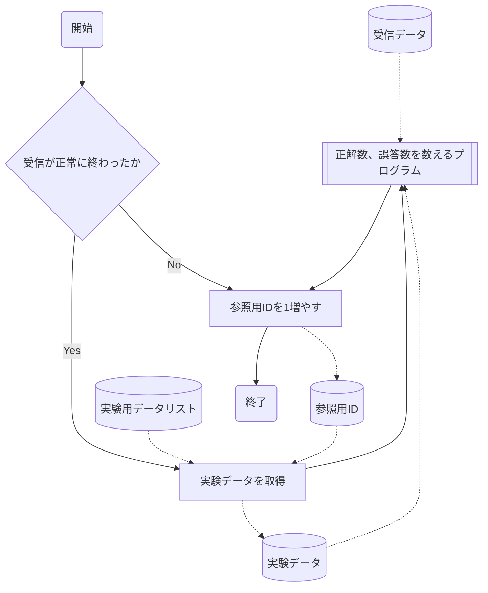

# 目的
音波通信のプログラムの正確度を測る実験用プログラムを作る。

# プログラム
## 大まかなプログラムの流れ
実験用データのリストをあらかじめ作成して、送信側と受信側の双方に持たせる。
そして通信し、受信側で、受け取ったデータと実験データを照合する。これをリストにある実験データの数だけ行う。
## 実験用データリストの作成

| 内容                   | 詳細     |
| ---------------------- | -------- |
| 実験データリストの形式 | JSON     |
| 実験データの型         | 文字列型 |
### 実験用データリストを作成するプログラムの設計
1. アルファベットを50文字ランダムに選んで文字列を作る。
2. それに通し番号を付けてファイルに出力する。
3. これを実験データの数だけ行う。
この作業をする。

JSON形式として以下のものを想定する。そして以下の条件で作成する。
```json
[
	{
		"id":(通し番号),
		"string_data":"(文字列)",
	}
]
```
- idはそのデータの通し番号である。最初は0から始まる。
- string_dataは50文字のランダムな文字列である。
このとき、以下のプログラムになる。

## 実験用プログラム
### 前提
送信側で実験用データリストからデータが1つ受信側に送られたときに1回動作する。
つまり1回の送受信で1回作動する。
また送信、受信のモジュールは今までのを流用する。
### 正解数、誤答数を数えるプログラムの作成
1. 1文字ずつ受信データと実験用データを照らし合わせる。
2. 一致した数と一致しなかった数を記録してファイルに出力する。
この作業をする。

| 用いるデータ | 内容                                                           |
| ------------ | -------------------------------------------------------------- |
| 受信データ   | 受信した音波をすでに周波数解析や文字変換を通したもの。         |
| 実験用データ | 受信データに対応する、実験用データリストから参照してきたもの。 |
| 一致数       | 受信データの中で実験データと一致していた文字数                 |
| 不一致数     | 受信データの中で実験データと一致していなかった文字数           |
| 出力ファイル | JSON形式またはCSV形式で、正解数と誤答数を含む                  |


### 実験の大枠のプログラム
1. 実験が始まり、受信が終わったら「正解数、誤答数を数えるプログラム」を起動して引数も適切に渡す。
2. プログラムが終わったら実験用データリストから参照するIDを1増やす。
3. ただし受信が正常に終わらなかった場合は「正解数、誤答数を数えるプログラム」は起動せずに参照するIDを1増やす
この作業をする。

| 用いるデータ       | 内容                                                     |
| ------------------ | -------------------------------------------------------- |
| 受信データ         | 受信した音波をすでに周波数解析や文字変換を通したもの。   |
| 実験用データリスト | 実験用に作成したデータリスト                             |
| 参照用ID           | 実験用データリストから適切な実験データを参照するためのID |
| 実験データ         | 実験用データリストからidが参照用IDと一致するもの。       |
